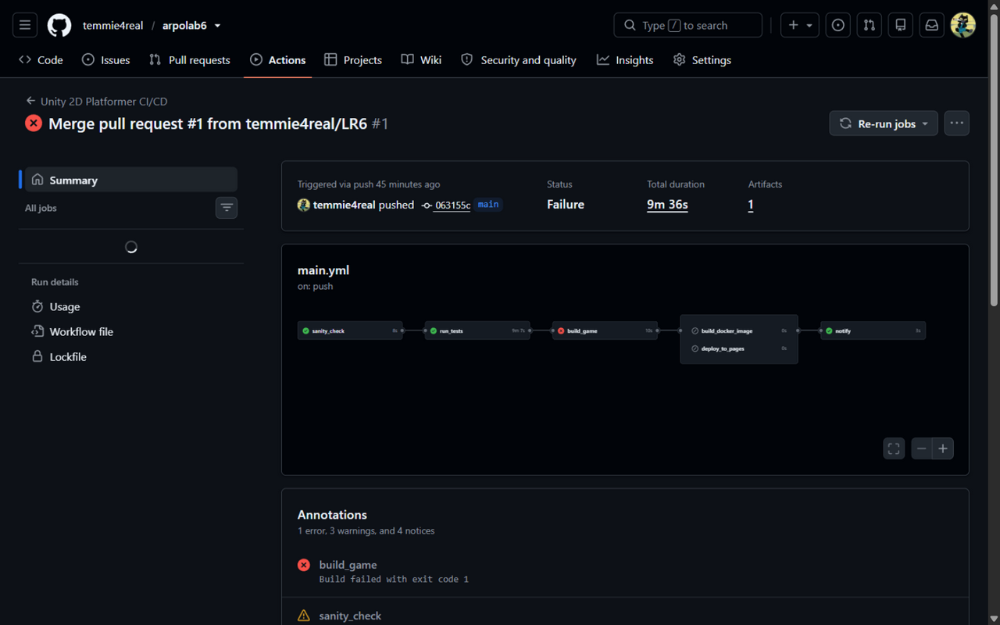
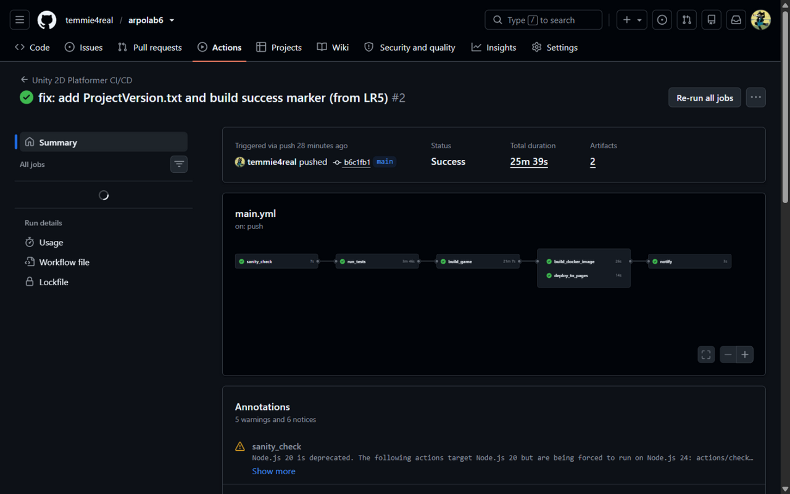
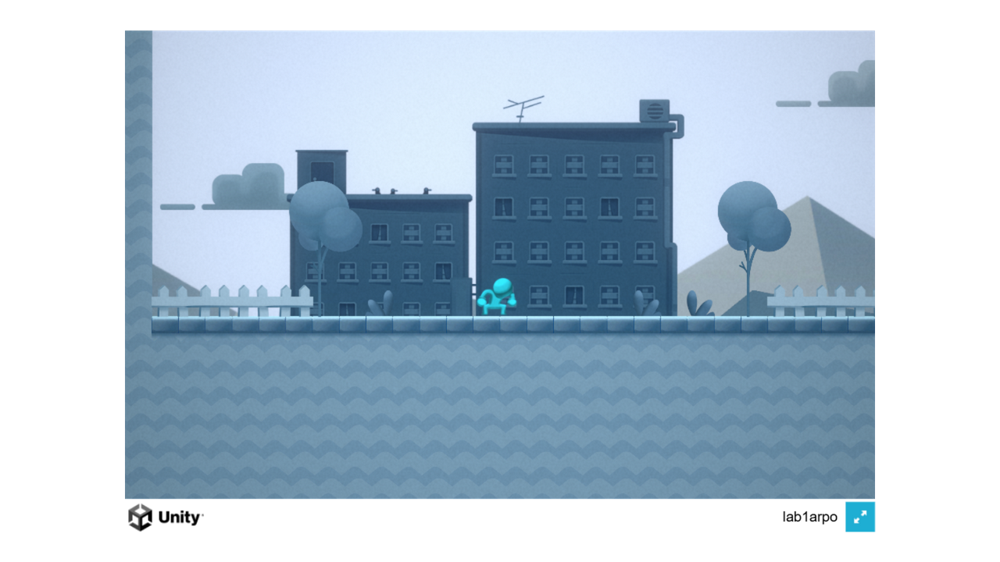
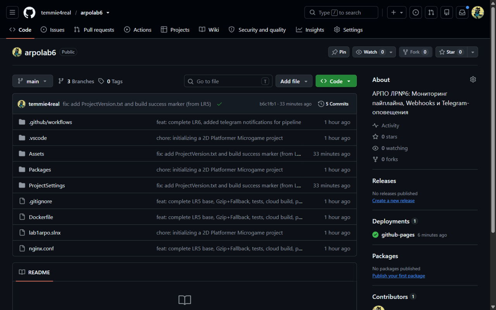

# Лабораторная работа №6. Мониторинг пайплайна, Webhooks и Telegram-оповещения

Студент: Сергей Шнитко

Репозитории:
- https://github.com/temmie4real/arpolab6 (текущий)
- https://github.com/temmie4real/arpolab5 (ЛР №5)
- https://github.com/temmie4real/arpolab1 (ЛР №1, ЛР №2)

**Живая игра:** https://temmie4real.github.io/arpolab6/

Цель работы: настроить обратную связь от облачного сервера к команде разработки при помощи мессенджера — после каждого прогона пайплайна Telegram-бот отправляет сообщение с результатом (успех — со ссылкой на игру, падение — с именем упавшей задачи и логом).

## Ход работы

### Шаг 1: Создание Telegram-бота и получение параметров доступа

Через официального **@BotFather** создал бота командой `/newbot`: имя «lab6arpo», username **@lab6arpobot**, получил токен вида `123456789:AAH...`. Создал личный чат с ботом и отправил `/start` (бот не может написать первым). Идентификатор чата получил запросом `getUpdates` — в ответе поле `chat.id` (личный чат: `975461875`).

Проверка канала связи — тестовое сообщение методом `sendMessage` пришло в чат, то есть токен и chat_id корректны:

```
curl -s -X POST "https://api.telegram.org/bot<TOKEN>/sendMessage" \
  -H "Content-Type: application/json" \
  -d '{"chat_id":"975461875","text":"Проверка связи"}'
```

### Шаг 2: Добавление секретов в репозиторий

В Settings → Secrets and variables → Actions создал 4 секрета: `UNITY_EMAIL`, `UNITY_PASSWORD` (лицензия Unity для облачной сборки из ЛР №4–5) и новые `TELEGRAM_BOT_TOKEN`, `TELEGRAM_CHAT_ID`. Токен и chat_id нигде не хранятся в коде — только в секретах; в логах прогона GitHub маскирует их звездочками.

### Шаг 3: Задача notify в пайплайне

В `.github/workflows/main.yml` добавлена шестая задача `notify`:

- **`needs: [ sanity_check, run_tests, build_game, build_docker_image, deploy_to_pages ]`** — включена в список зависимостей всех задач пайплайна;
- **`if: always()`** — гарантия запуска при любом исходе (аналог `after_script` в других CI): даже если какая-то задача упала, уведомление все равно уйдет;
- Первый шаг (`Determine pipeline status`) по значению `needs.<задача>.result` определяет первую упавшую задачу (или `none`, если все зелёные);
- Второй шаг методом Telegram Bot API `sendMessage` отправляет JSON через `curl`: при `stage=none` — сообщение об успехе с автором коммита, ссылкой на игру (`https://temmie4real.github.io/arpolab6/`) и на прогон; иначе — имя упавшей задачи и ссылка на лог.

Секреты читаются в env задачи из `secrets.TELEGRAM_BOT_TOKEN` и `secrets.TELEGRAM_CHAT_ID` — в тексте пайплайна их нет.

### Шаг 4: Проверка обоих сценариев

**Аварийный сценарий.** Первый прогон после влития PR упал на задаче `build_game` (в копию проекта из ЛР №5 случайно не попали `ProjectVersion.txt` и маркер успешной сборки для валидатора CLI). Пайплайн отработал ровно как задумано: `run_tests` прошел, `build_game` упал, `build_docker_image` и `deploy_to_pages` не запустились, а задача **notify осталась зеленой** и бот прислал сообщение «Сборка 2d_platformer упала на задаче build_game» с автором коммита и ссылкой на лог. После исправления файлы добавлены и запушены:



**Успешный сценарий.** Следующий прогон прошел полностью зеленый за 25 минут (все 6 задач, включая облачную компиляцию игры из ЛР №5 и деплой на Pages), и бот прислал сообщение об успешной сборке со ссылкой на игру и на прогон:



Оба сообщения от бота получены в Telegram (скриншоты чата с ботом — в приложенных материалах к работе).

### Шаг 5: Проверка результата

Помимо уведомлений, полный пайплайн ЛР №5 продолжил работать без изменений: игра собрана в облаке и доступна на **https://temmie4real.github.io/arpolab6/**:



Отчет по лабораторной работе размещен в README основного репозитория:



## Результаты

- В main.yml присутствует задача `notify` с `needs` на все задачи пайплайна и условием `if: always()`.
- Токен бота и chat_id хранятся только в секретах `TELEGRAM_BOT_TOKEN` и `TELEGRAM_CHAT_ID`; в логах значения маскируются.
- Оба сценария продемонстрированы: зеленый прогон (сообщение об успехе со ссылкой на игру) и упавший прогон (сообщение с именем упавшей задачи `build_game` и ссылкой на лог), после чего конфигурация возвращена в рабочее состояние.
- Telegram-бот: @lab6arpobot.
